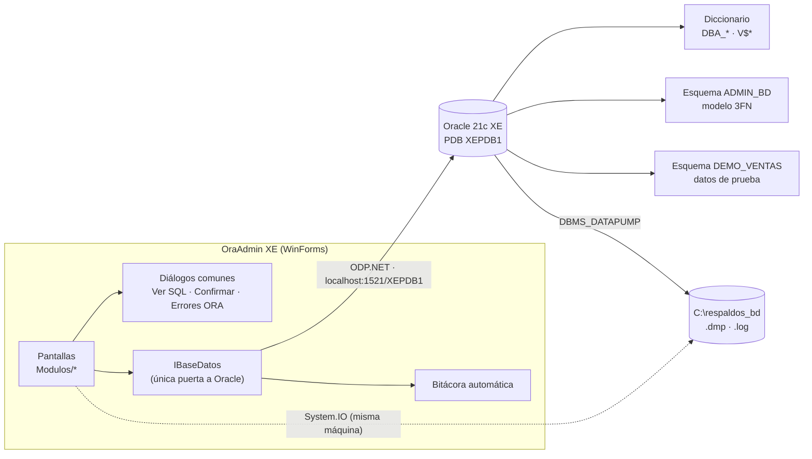

<div align="center">

# 🛢️ OraAdmin XE

**Consola de administración y respaldos para Oracle Database 21c Express Edition**

Proyecto Final · EIF-402 Administración de Bases de Datos · Universidad Nacional · II ciclo 2026


</div>

---

## ¿Qué es?

OraAdmin XE es una aplicación de escritorio para Windows con la que un DBA administra una base **Oracle 21c XE** desde una sola ventana: tablespaces, tuning de consultas, rendimiento, auditoría, seguridad de usuarios y, sobre todo, **respaldos y recuperación con Data Pump**. Todo lo que hace queda registrado en una bitácora, y cada acción permite ver el SQL exacto antes de ejecutarlo.

## Módulos

| # | Módulo | Qué permite hacer |
|:-:|---|---|
| 0 | **Login** | Conectarse a `XEPDB1` y validar que el usuario tenga privilegios de DBA |
| 1 | **Inicio** | Ver el estado de la instancia, las sesiones, el % usado de cada tablespace y el último respaldo |
| 2 | **Tablespaces** | Listar con % usado, crear, agregar o redimensionar datafiles, autoextend, online/offline, read only y eliminar |
| 3 | **Tuning** | Ver el plan de ejecución (estimado y real), recolectar estadísticas, administrar índices y comparar el antes y el después |
| 4 | **Performance** | Ver sesiones, bloqueos, top SQL, eventos de espera, SGA/PGA y un gráfico en vivo, y matar sesiones |
| 5 | **Auditoría** | Crear, activar y desactivar políticas de auditoría unificada y consultar la pista con filtros |
| 6 | **Seguridad** | Administrar usuarios, roles, privilegios y perfiles |
| 7 | **Respaldos** | Hacer respaldos **Full**, **por esquema** y **por tabla** con `DBMS_DATAPUMP`, ver el progreso y el log |
| 8 | **Recuperación** | Restaurar desde el catálogo de respaldos, con remapeo de esquema y la acción a tomar si la tabla ya existe |
| 9 | **Directorios y archivos** | Administrar objetos `DIRECTORY` y los archivos `.dmp`/`.log`: listar, ver, borrar y renombrar |
| 10 | **Bitácora** | Ver el historial de todo lo ejecutado desde la app, con su SQL y su resultado |

## Stack

| Capa | Tecnología |
|---|---|
| Aplicación | C# 12 · .NET 8 · Windows Forms (Visual Studio 2022) |
| Acceso a Oracle | [`Oracle.ManagedDataAccess.Core`](https://www.nuget.org/packages/Oracle.ManagedDataAccess.Core) (no requiere instalar Oracle Client) |
| Gráficos | [`ScottPlot.WinForms`](https://scottplot.net/) |
| Base de datos | Oracle Database 21c Express Edition, PDB `XEPDB1` |
| Respaldos | Data Pump vía `DBMS_DATAPUMP` (el mismo motor de `expdp`/`impdp`) |

## Arquitectura



Más detalle en [`docs/diseno.md`](docs/diseno.md).

## Instalación y primer arranque

> **Requisitos:** Windows 10/11, Oracle 21c XE instalado, [Visual Studio 2022](https://visualstudio.microsoft.com/es/vs/community/) con la carga de trabajo **Desarrollo de escritorio de .NET**, y Git.

**1. Clonar**

```bash
git clone https://github.com/marcovinir/oraadmin-xe.git
cd oraadmin-xe
```

**2. Preparar la base de datos** (una sola vez por máquina, en **cmd** desde la carpeta del repo)

```bat
mkdir C:\respaldos_bd
set NLS_LANG=SPANISH_COSTA RICA.AL32UTF8
sqlplus / as sysdba @sql/00_setup_sys.sql
sqlplus admin_bd@localhost:1521/XEPDB1 @sql/01_modelo_3fn.sql
sqlplus admin_bd@localhost:1521/XEPDB1 @sql/02_demo_ventas.sql
```

| Script | Se corre como | Qué hace |
|---|---|---|
| [`00_setup_sys.sql`](sql/00_setup_sys.sql) | `SYS` | Crea el usuario `ADMIN_BD` (pide la contraseña), le da los privilegios y crea `DIR_RESPALDOS` |
| [`01_modelo_3fn.sql`](sql/01_modelo_3fn.sql) | `ADMIN_BD` | Crea las 13 tablas del modelo en 3FN, los índices, las vistas y los catálogos |
| [`02_demo_ventas.sql`](sql/02_demo_ventas.sql) | `ADMIN_BD` | Crea el esquema `DEMO_VENTAS` con 252 500 filas de prueba |
| [`99_limpieza.sql`](sql/99_limpieza.sql) | `SYS` | Borra todo para reinstalar desde cero |

**3. Abrir y correr la app**

Abrir `OraAdminXE.sln` en Visual Studio y presionar **F5**. Para conectarse se usa `localhost`, `1521`, `XEPDB1` y `ADMIN_BD` con su contraseña.

> 💡 Si `sqlplus / as sysdba` dice *ORA-01031*, el usuario de Windows no está en el grupo `ORA_DBA`. En ese caso hay que usar `sqlplus sys@localhost:1521/XEPDB1 as sysdba` con la contraseña de SYS que se definió al instalar XE.

## Estructura del repositorio

```text
oraadmin-xe/
├── OraAdminXE.sln
├── src/OraAdminXE/
│   ├── Program.cs              arranque: login → ventana principal
│   ├── Datos/                  IBaseDatos, BaseDatos, Sesion, Modulo, ConfigConexion
│   ├── UI/                     FrmLogin, FrmPrincipal, ModuloBase, Dialogos, Tema
│   └── Modulos/                una carpeta por pantalla (Tablespaces/, Respaldos/, …)
│       └── RegistroModulos.cs  orden del menú lateral
├── sql/                        scripts de instalación (00, 01, 02, 99)
├── docs/
│   ├── diseno.md               documento de diseño: alcance, pantallas, reglas, decisiones
│   ├── modelo-datos.md         diagrama E-R y justificación de la 3FN
│   ├── referencia-sql.md       consultas y sentencias probadas de cada módulo
│   ├── guion-demo.md           guion de la presentación y plan B
│   └── manual/                 manual de usuario (máx. 4 páginas)
└── .github/                    plantillas de issues y pull requests
```

## Equipo

| Rol | Módulos | Integrante |
|---|---|---|
| **Persona 1 — Núcleo** | Login, Inicio, Bitácora, Seguridad + capa de datos y diálogos | _por asignar_ |
| **Persona 2 — Respaldos** | Respaldos, Recuperación | _por asignar_ |
| **Persona 3 — Almacenamiento y auditoría** | Tablespaces, Directorios y archivos, Auditoría + manual | _por asignar_ |
| **Persona 4 — Rendimiento** | Tuning, Performance | _por asignar_ |

## Cronograma

| Fecha | Hito | Qué tiene que estar listo |
|---|---|---|
| Lun 26 oct | 🏁 Arranque | Repo clonado y scripts corridos en las 4 máquinas, y cada quien prueba sus consultas en SQL Developer |
| **Mar 27 oct** | **M1 · Base** | Capa de datos, diálogos y login en `main`: **nadie se queda bloqueado** |
| **Jue 29 oct** | **M2 · Módulos funcionales** | Cada pantalla lista sus datos y ejecuta su acción principal |
| **Vie 30 oct** | **M3 · Funcionalidad completa** | Todas las acciones del enunciado, con bitácora, confirmaciones y errores ORA. **Se congela la funcionalidad** |
| Sáb 31 oct – Dom 1 nov | **M4 · Presentación** | Prueba en una máquina limpia o del laboratorio, manual de 4 páginas, release `v1.0` y dos ensayos |
| **Lun 2 nov** | 🎤 **Presentación** | — |

El avance se sigue en las [**issues**](../../issues) y los [**milestones**](../../milestones). El punto de entrada es la issue **#1 · Hoja de ruta**.

## Cómo trabajamos

Ramas `feature/<módulo>`, commits pequeños y Pull Requests revisados por otra persona antes de entrar a `main`. El detalle está en [**CONTRIBUTING.md**](CONTRIBUTING.md).

## Evaluación

| Rubro | Peso |
|---|---|
| Presentación: ventanas o pantallas | 20 % |
| Presentación: funcionalidad | 70 % |
| Manual de usuario (máx. 4 páginas) | 10 % |

---

<div align="center">
<sub>Universidad Nacional · Escuela de Informática · Sede Interuniversitaria de Alajuela · Prof. MAP. Rodolfo Sánchez Sánchez</sub>
</div>
