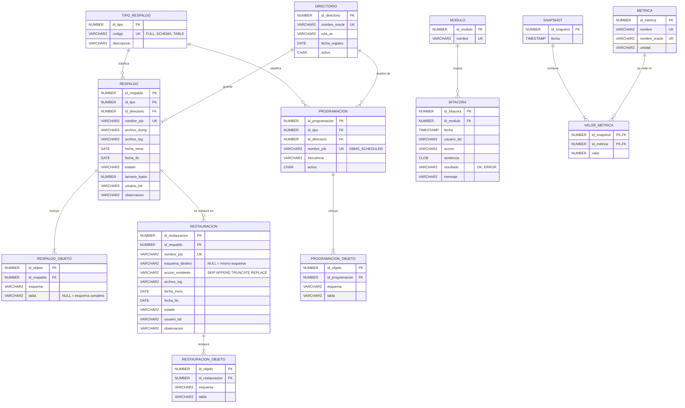
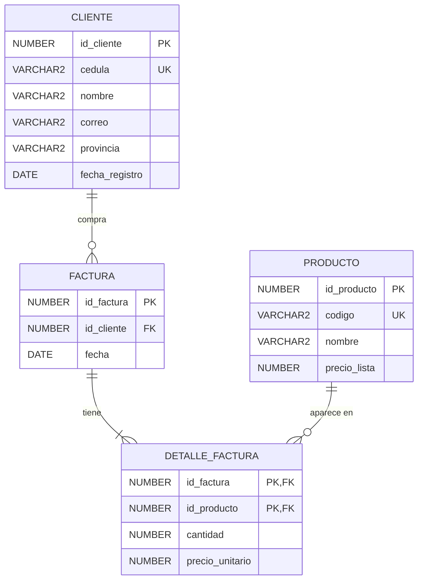

# Modelo de datos (3FN)

La app guarda su propia información en el esquema **`ADMIN_BD`**: el catálogo de respaldos y restauraciones, las programaciones, la bitácora y el historial de rendimiento. Son **13 tablas en tercera forma normal**. El script es [`sql/01_modelo_3fn.sql`](../sql/01_modelo_3fn.sql).

Además existe el esquema de prueba **`DEMO_VENTAS`** (4 tablas, también en 3FN), que sirve para tener algo que respaldar, borrar, restaurar, auditar y optimizar.

## Diagrama E-R — `ADMIN_BD`

## Diccionario de tablas

| Tabla | Para qué | PK | FK | Lo usa |
|---|---|---|---|---|
| `TIPO_RESPALDO` | Catálogo: FULL, SCHEMA, TABLE | `id_tipo` | — | Respaldos |
| `DIRECTORIO` | Objetos `DIRECTORY` registrados y su ruta en disco | `id_directorio` | — | Directorios, Respaldos |
| `RESPALDO` | Cada respaldo ejecutado: archivos, fechas, estado y tamaño | `id_respaldo` | `id_tipo`, `id_directorio` | Respaldos, Recuperación, Directorios |
| `RESPALDO_OBJETO` | Esquemas o tablas incluidos en cada respaldo | `id_objeto` | `id_respaldo` | Respaldos, Recuperación |
| `RESTAURACION` | Cada recuperación hecha desde un respaldo | `id_restauracion` | `id_respaldo` | Recuperación |
| `RESTAURACION_OBJETO` | Esquemas o tablas restaurados | `id_objeto` | `id_restauracion` | Recuperación |
| `PROGRAMACION` | Respaldos programados con `DBMS_SCHEDULER` *(extra)* | `id_programacion` | `id_tipo`, `id_directorio` | Respaldos |
| `PROGRAMACION_OBJETO` | Objetos de cada respaldo programado *(extra)* | `id_objeto` | `id_programacion` | Respaldos |
| `MODULO` | Catálogo de módulos de la app | `id_modulo` | — | Bitácora |
| `BITACORA` | Cada acción ejecutada desde la app | `id_bitacora` | `id_modulo` | Todos |
| `METRICA` | Catálogo de métricas y su nombre en `V$SYSMETRIC` | `id_metrica` | — | Performance |
| `SNAPSHOT` | Momento en que se tomó una muestra de rendimiento | `id_snapshot` | — | Performance |
| `VALOR_METRICA` | Valor de cada métrica en cada muestra | (`id_snapshot`, `id_metrica`) | ambas | Performance |

**Vistas:** `V_RESPALDOS`, `V_RESTAURACIONES` y `V_BITACORA` unen los catálogos y calculan los datos derivados, como la duración y el tamaño en MB.

## Por qué cumple 1FN, 2FN y 3FN

Esta sección sirve para explicarlo en la presentación.

### 1FN — valores atómicos y sin grupos repetidos

- Los objetos de un respaldo **no** se guardan como `'HR,SCOTT'` en una sola columna. Cada esquema o tabla es una fila de `RESPALDO_OBJETO`, y lo mismo pasa con `RESTAURACION_OBJETO` y `PROGRAMACION_OBJETO`.
- Las métricas de una muestra no son columnas `cpu`, `sesiones`, `hit_ratio`… en `SNAPSHOT`. Son filas de `VALOR_METRICA`, así que agregar una métrica nueva no cambia la estructura.
- Todas las tablas tienen llave primaria.

### 2FN — sin dependencias parciales

- La única llave compuesta es la de `VALOR_METRICA` (`id_snapshot`, `id_metrica`). `valor` depende de la llave **completa** (qué métrica en qué muestra). El nombre y la unidad dependen solo de la métrica, por eso viven en `METRICA`. La fecha depende solo de la muestra, por eso vive en `SNAPSHOT`.
- El resto de las tablas tiene llave simple (identity), así que no puede haber dependencias parciales.

### 3FN — sin dependencias transitivas

- La **ruta en disco** depende del directorio, no del respaldo. Por eso está en `DIRECTORIO` y no se repite en cada `RESPALDO`.
- La **descripción del tipo** depende del tipo, así que va en `TIPO_RESPALDO`. El **nombre del módulo** va en `MODULO`, y el **nombre y la unidad de la métrica** en `METRICA`.
- El **archivo y el directorio de una restauración** se obtienen desde su respaldo (`RESTAURACION → RESPALDO → DIRECTORIO`) y no se copian.
- **Los datos derivados no se guardan:** la duración (`fecha_fin - fecha_inicio`) y el tamaño en MB se calculan en las vistas `V_RESPALDOS` y `V_RESTAURACIONES`.
- En las tablas donde hay más de una llave candidata (por ejemplo, `DIRECTORIO.nombre_oracle` o `METRICA.nombre_oracle`), cada atributo depende de una llave candidata. El modelo también cumple **FNBC**.

### Integridad

- `CHECK` en estados, acciones, códigos y fechas (`fecha_fin >= fecha_inicio`).
- `UNIQUE` en nombres de job, en archivo por directorio y en objetos por respaldo.
- `ON DELETE CASCADE` solo de una tabla de detalle a su encabezado (`*_OBJETO`, `VALOR_METRICA`).
- Índices en todas las llaves foráneas, porque Oracle no los crea solo.
- Al borrar un archivo de respaldo, la fila **no** se elimina: pasa a `estado = 'ELIMINADO'` y queda el historial.

## Esquema de prueba — `DEMO_VENTAS`

| Tabla | Filas |
|---|---:|
| `CLIENTE` | 2 000 |
| `PRODUCTO` | 500 |
| `FACTURA` | 50 000 |
| `DETALLE_FACTURA` | 200 000 |

`DETALLE_FACTURA.precio_unitario` **no** es redundante con `PRODUCTO.precio_lista`: es el precio **al momento de la venta**, un hecho propio del detalle. Tampoco se guarda el total de la factura, porque se calcula con `SUM(cantidad * precio_unitario)`.

> ⚠️ `DETALLE_FACTURA(id_producto)` **no tiene índice a propósito**: es la demo del módulo de Tuning (FULL SCAN → crear índice → INDEX RANGE SCAN).

Para el manual o la presentación, el diagrama también se puede generar en SQL Developer Data Modeler: *File → Import → Data Dictionary*, esquema `ADMIN_BD`.
